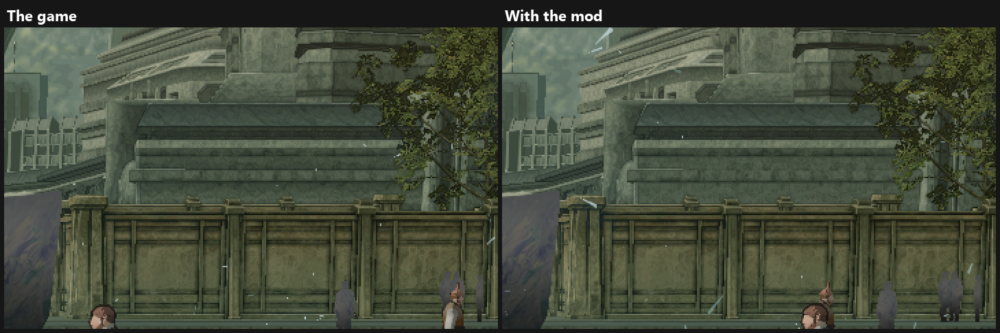
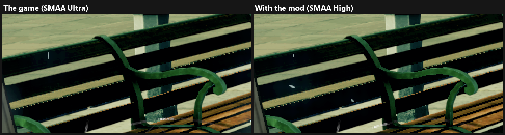
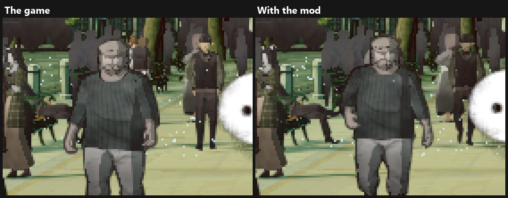
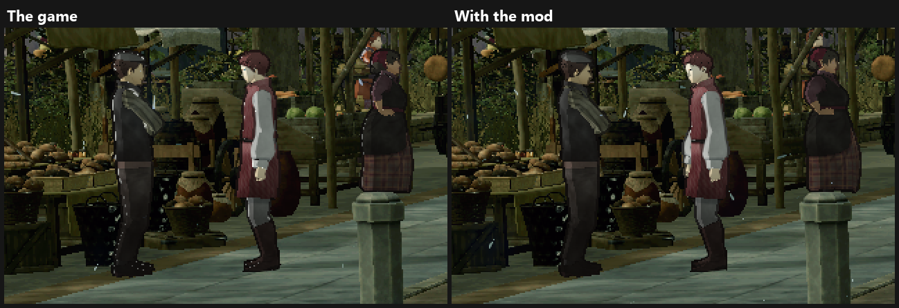
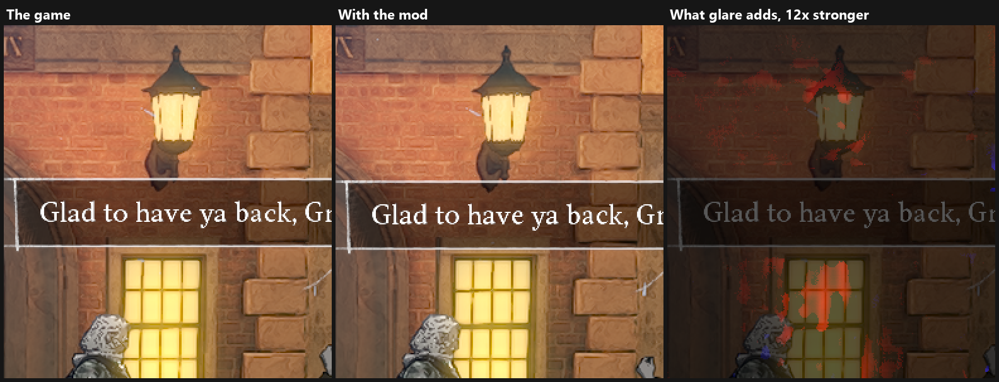
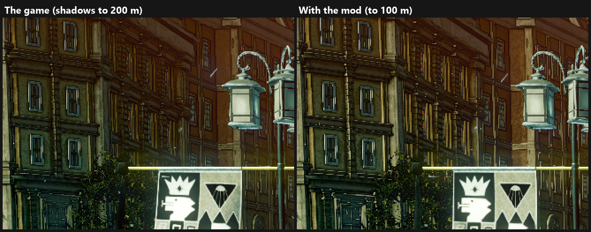
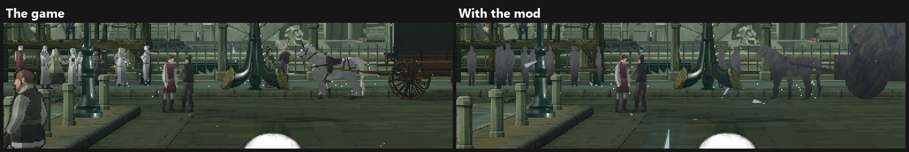
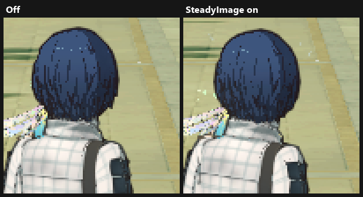
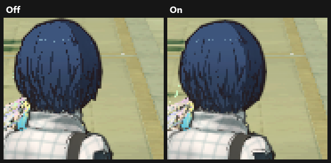
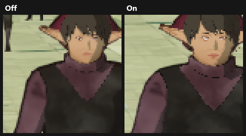

# Visual comparison

What each change looks like, in the order of the table in [RESULTS.md](RESULTS.md). Under each name are its GPU time per frame and its battery power on the Android test tablet: **−** is a saving and **+** a cost. Each picture shows that one change alone, from the PC at 1920×1080, and people and particles move between the two shots. Click a picture to see it at full size.

### Shadow-caster culling (static + animated casters)

**−4.4 ms · −0.9 W**

No visible change, so no picture.

### CPU fixes (job semaphore, spin / wait, no core pinning)

**0 ms · −0.3 W**

No visible change, so no picture.

### Simpler far meshes (incl. shadow casters by texel)

**−2.4 ms · −0.4 W**

Zoomed 2×: a distant wall and building keep their shape and detail with simpler meshes.

### Far shadows every 2nd frame

**−0.8 ms · −0.3 W**

No difference shows in a still picture, so no picture.

### SMAA High (instead of Ultra)

**−0.4 ms · −0.1 W**

Zoomed 3×: the edges of a bench.

### Character outlines within 40 m

**−0.2 ms · −0.2 W**

Zoomed 4×: the people farther down the street lose their thin dark outline; the nearer man keeps his.

### No toon rim light

**−0.2 ms · −0.1 W**

Zoomed 2×: the bright broken lines on the characters' backs are the rim light, and they shimmer in motion.

### Glare off (runs in the capital only)

**−0.4 ms · −0.2 W**

Zoomed 2×, at night: a faint glow around the lamp and the window. The third panel marks it in red.

### Shadows up to 100 m

**−0.6 ms · −0.4 W**

Zoomed 2×: a far building. Beyond 100 m the sun's shadows end, so its walls are a little brighter.

### Far NPCs animated every 2nd frame (beyond 50 m)

**−1.1 ms · −0.3 W**

No difference shows in a still picture, so no picture.

### NPC stand-ins from 60 m, adaptive down to 40 m

**−1.5 ms · −0.2 W**

Zoomed 2×: between 60 m and 100 m, people, horses and carts become the game's simple grey models. The people nearer than that stay as they are.

## Steadier image (off by default)

> **These changes are truly visible only in motion.** They work between frames, calming the shimmer of thin lines while the camera and the characters move. A still picture shows only a small part of that, so the close-ups below look much alike: judge it in the game. On PC, F7 switches it off and on while playing (also on android if you assign a virtual button to F7).

### Steadier image: one switch (`SteadyImage=on`: the four parts below + SMAA Medium)

**+2.4 ms · +0.5 W**

Zoomed 3×: the thin dark lines in the hair are smoother and less broken.

### Temporal stabilisation, characters (40%)

**+0.7 ms · +0.3 W**

Zoomed 3×: the thin dark lines in the hair are a little less broken.

It's worth using a stronger stabilization percentage, like 60 or 80% when characters motion vectors are also on.

### Temporal stabilisation, rest of the image (50%)

**+0.6 ms · +0.1 W**

Can only be seen in the game, on world models.

### ↳ World clamped to 4 neighbours

**−0.5 ms · 0 W**

No visible change, so no picture.

### Characters' motion vectors

**+1.3 ms · +0.1 W**

Zoomed 3×, with the stabilisation on: a walking woman's face and collar blur without her own motion and stay sharper with it. She has moved between the two shots.

